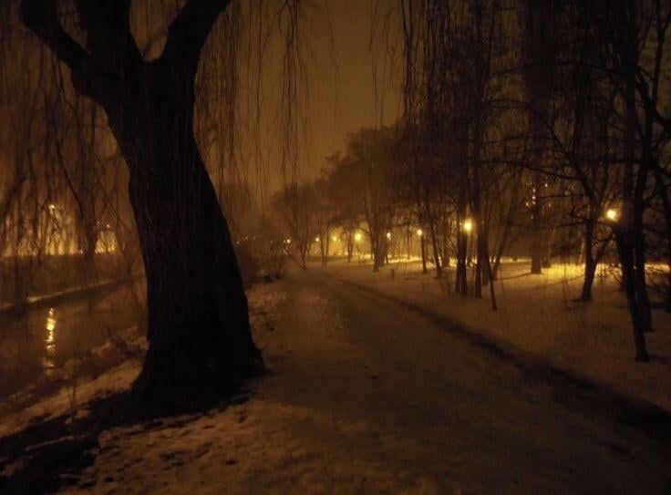

# Night Glow
A nostalgic, retro terminal theme with familiar amber glows yet plenty of contrast.

Inspired by a millennial-core fusion of high-pressure sodium street lamps and late nights in front of old monochromatic displays. The accent colors are derived from the rigid 8-bit terminal color palette if it were somehow tuned to be less visually harsh.

|  |  |
| --- | --- |

## Screenshots
TODO

## Language Extras
Additional sylization work has gone into the following languages (contributors linked where applicable).

- x86_64 Assembly
- ARM Assembly
- C
- C++
- [C3](https://github.com/c3lang/c3c)
- Bash
