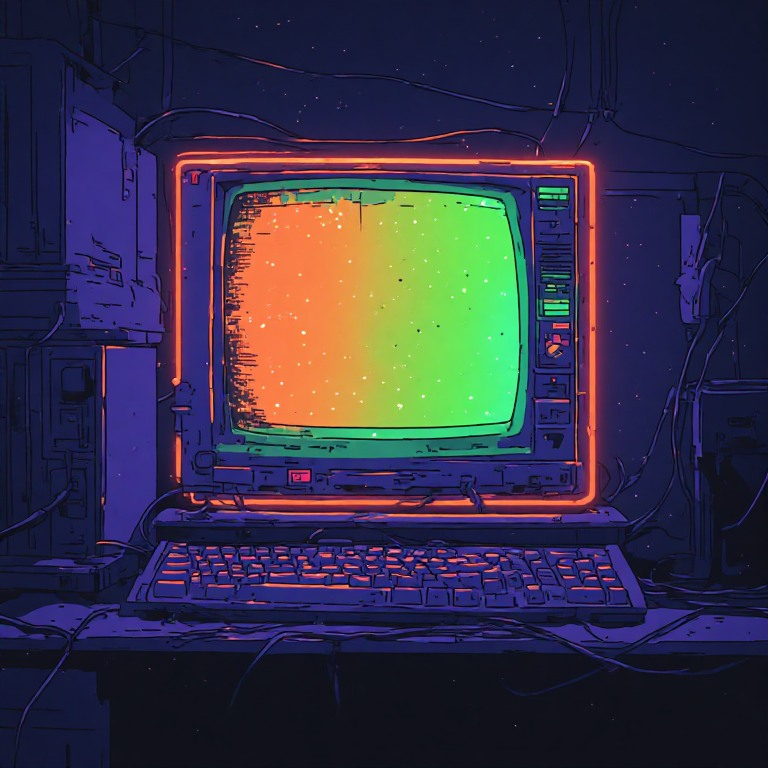
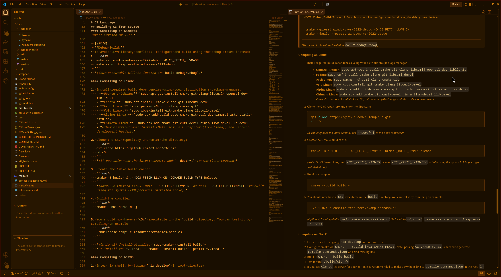
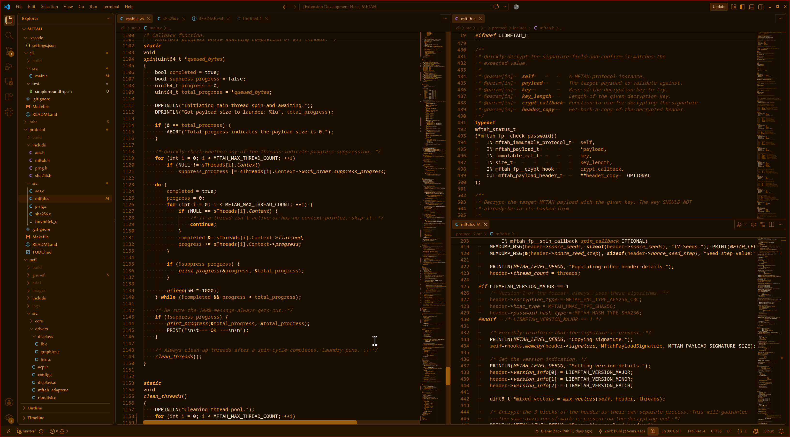
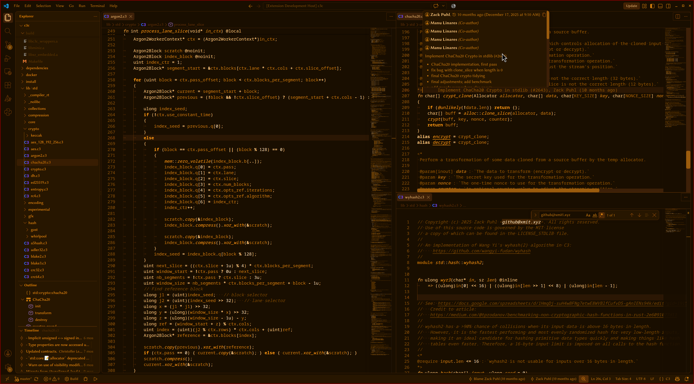
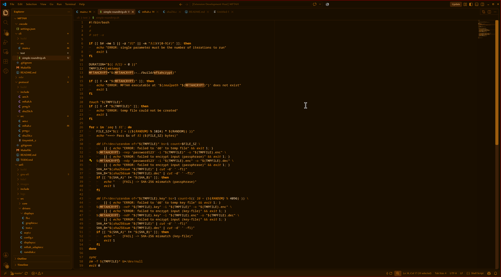
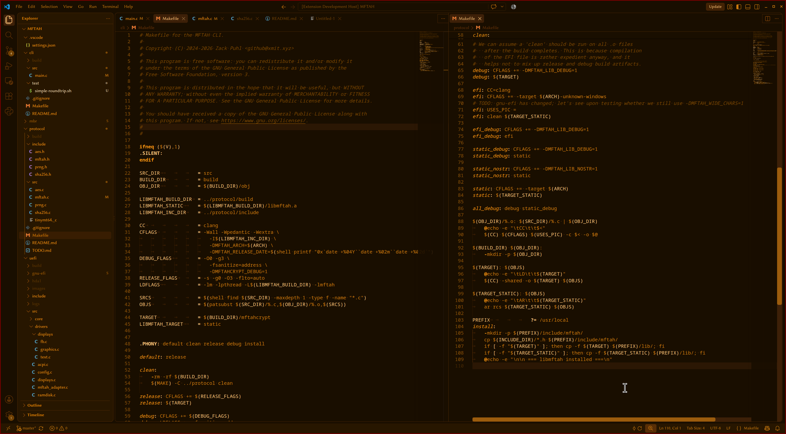

# Night Glow
A nostalgic, retro terminal theme with familiar amber glows yet plenty of contrast.

These IDE themes are inspired by a very millennial-core tandem of silent night-walks under sodium street lamp glows and late nights ablaze with softened terminal ANSI colors (as seen through bleary eyes). If you've been there, you know; if not, I'm sorry.

The monochromatic theme is based solely off the primary orange color found within the full-color theme (`#FB9711`), which itself is based off the nucleus of a quintessential operational-temperature sodium-based streetlight. For said full-color theme, all accent colors are derived from the rigid 8-bit terminal color palette if it were somehow tuned to be less visually harsh.

|  |  |
| :---: | :---: |
| <small>_(Monochromatic inspo)_</small> | <small>_(Slopified full-color inspo)_</small> |

## Screenshots
| Language | Monochromatic | Full Color |
| ----- | :-----: | :-----: |
| `Markdown` |  | _TODO_ |
| `C` |  | _TODO_ |
| `C3` |  | _TODO_ |
| `Bash` |  | _TODO_ |
| `Makefile` |  | _TODO_ |

## Wishlist &amp; Languages with Specific Support
_Note: An item that's checked off here might still have some outlier symbols and classifiers to cover._

- [x] Markdown
- [ ] x86_64 Assembly
- [ ] ARM Assembly
- [x] C
- [ ] C++
- [x] [C3](https://github.com/c3lang/c3c)
- [x] Bash
- [x] Makefile
